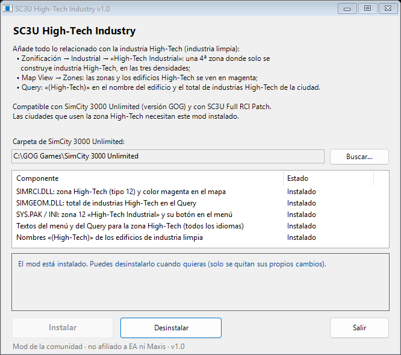
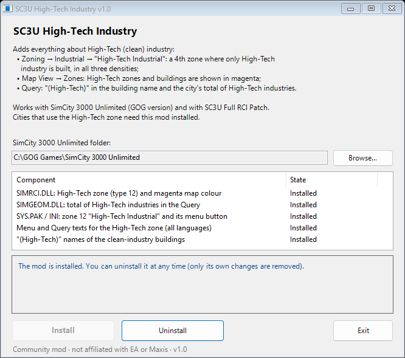

# SC3U High-Tech Industry

**SimCity 3000 Unlimited (GOG)** · una 4ª zona industrial «High-Tech», industria High-Tech en magenta en el mapa
e información en el Query · *a 4th "High-Tech" industrial zone, High-Tech industry in magenta on the map and
Query information*

[Español](#español) · [English](#english)

---

## Español

### Qué añade
- **Zonificación → Industrial → «High-Tech Industrial»**: una cuarta zona industrial (junto a Light, Medium y
  Dense) donde solo se construye **industria High-Tech** (industria limpia), en las tres densidades, sin
  depender del nivel de educación ni de las ordenanzas.
- **Map View → Zones**: las zonas High-Tech y todos los edificios de industria High-Tech se pintan en **magenta**,
  para ver dónde están.
- **Query**: el nombre de cada edificio de industria limpia lleva **«(High-Tech)»**, y el Query de cualquier
  edificio de zona muestra **«High-Tech industries in city: N»** con el total de la ciudad.

Los textos nuevos (menú y «Zone Type:» del Query) están en los 7 idiomas del juego.

### ¿Afecta a todo lo que conlleva la industria?
Sí: lo que se construye en la zona High-Tech son los mismos edificios de industria limpia del juego (tipos
8700/8900/9100), así que **empleos, impuestos industriales, contaminación, tráfico, electricidad, agua y la
demanda industrial** funcionan igual que en cualquier industria limpia. Diferencias:
- la zona High-Tech **no baja el valor del suelo** de los alrededores (el juego solo penaliza las zonas industriales 9–11);
- el asesor **City Planner** solo cuenta la superficie de las zonas industriales normales;
- las parcelas vacías se dibujan como industria densa (el color propio se ve en Map View → Zones);
- zonificar cuesta lo mismo que la zona densa.

> **Importante:** las ciudades guardadas con zonas High-Tech necesitan el mod instalado. Sin él esas parcelas
> quedan como zona que nunca se construye.

### Descarga e instalación
1. Descarga `SC3U_HighTech_Industry_v1.0.zip` desde [Releases](../../releases/latest) y descomprímelo.
2. Cierra SimCity 3000.
3. Abre `SC3U_HighTech_Industry.exe`; busca el juego solo o pulsa **Buscar…** y elige la carpeta de SimCity
   3000 Unlimited (la que contiene `Apps`).
4. Pulsa **Instalar**.

Si Windows muestra «Windows protegió tu PC» (SmartScreen), pulsa *Más información → Ejecutar de todas formas*.
Si dice que no tiene permiso, ábrelo con *clic derecho → Ejecutar como administrador*.

### Desinstalación
Pulsa **Desinstalar**: se deshace exactamente cada cambio del mod y nada más (si otro mod editó los mismos
archivos, sus cambios se conservan). También se guardan copias de los originales en `SC3U_Mod_Backups\HighTech`
y `Apps\SIMRCI.DLL.orig` / `Apps\SIMGEOM.DLL.orig`.

### Compatibilidad
- SimCity 3000 Unlimited **versión GOG**. Si algún archivo no es el esperado, el programa avisa y no cambia nada.
- Funciona junto con **[SC3U Full RCI Patch](https://github.com/apatuka/sc3u-full-rci-patch)**, en cualquier orden.

### Detalles técnicos
| Archivo | Cambio |
|---|---|
| `SIMRCI.DLL` | zona 12 (sin usar en el juego): `CreateTool` `0x1000BD41` (comando de menú `0xC8545A31`), `ChooseNewBuilding` `0x10018A08` (sin lista de industria sucia → siempre limpia), `GetZoneDisplayIndex` `0x10035518` (dibujo de parcela), `ZoneArea` `0x10035FBE` (costo), etiqueta del Query (entrada 12 de la tabla de saltos `0x100353AD`), color 12 del mapa de zonas = magenta; `GetCellColor` `0x10036169` pinta en magenta los edificios de tipo 8700/8900/9100. Código nuevo en `0x1004A1E0–0x1004A38B`. |
| `SIMGEOM.DLL` | Query de edificio (`0x100249B3`): recorre el mapa y cuenta los edificios High-Tech (una vez cada uno, en su casilla de origen). Código nuevo en `0x10028460`. |
| `Apps\Sys\SYS.PAK` (+ copias sueltas) | `SC3ZoneLayer.ini`: desarrollador de la zona 12 con solo industria limpia y las reglas de lote de la zona densa; `MenuItem.INI`: 4º botón del submenú Industrial. |
| `Res\Text\<idioma>\SC3StringsGUI.IXF`, `SC3StringsQuery.IXF` | texto «High-Tech Industrial» (registro `0x4801`). |
| `Res\Occupant\*.IXF`, `Res\Text\<idioma>\*StringsBuildings*.IXF` | « (High-Tech)» al final del nombre de los edificios de industria limpia. |

Los bloques de los DLL están en [`src/PatchData.cs`](src/PatchData.cs), generado desde el ensamblador de
[`tools/`](tools). El código nuevo no usa direcciones absolutas; la única entrada reubicada que se toca es la de
la tabla de saltos, que conserva su reubicación.

### Compilar y probar
`build.cmd` compila con el `csc.exe` de Windows (.NET Framework 4).
`python tests\test_patcher.py "<copia de la carpeta del juego sin modificar>" [<exe de otro mod SC3U>]`.
Línea de comandos: `SC3U_HighTech_Industry.exe --check|--install|--uninstall ["carpeta del juego"]`.

---

## English

### What it adds
- **Zoning → Industrial → "High-Tech Industrial"**: a fourth industrial zone (next to Light, Medium and Dense)
  where only **High-Tech industry** (clean industry) is built, in all three densities, regardless of education
  level or ordinances.
- **Map View → Zones**: High-Tech zones and every High-Tech industry building are painted **magenta**, so you
  can see where they are.
- **Query**: clean-industry buildings carry **"(High-Tech)"** in their name, and the Query of any zoned building
  shows **"High-Tech industries in city: N"** with the city total.

The new texts (menu and the Query "Zone Type:") are available in the game's 7 languages.

### Does it affect everything related to industry?
Yes: the High-Tech zone builds the game's own clean-industry buildings (types 8700/8900/9100), so **jobs,
industrial taxes, pollution, traffic, power, water and industrial demand** work exactly as for any clean
industry. Differences:
- the High-Tech zone **does not lower nearby land value** (the game only penalises industrial zones 9–11);
- the **City Planner** advisor only counts the area of the normal industrial zones;
- empty lots are drawn like dense industrial ones (the zone's own colour is shown in Map View → Zones);
- zoning costs the same as dense zoning.

> **Important:** cities saved with High-Tech zones need the mod installed. Without it those lots stay as a zone
> that never develops.

### Download and install
1. Download `SC3U_HighTech_Industry_v1.0.zip` from [Releases](../../releases/latest) and unzip it.
2. Close SimCity 3000.
3. Run `SC3U_HighTech_Industry.exe`; it finds the game by itself, or press **Browse…** and pick the SimCity 3000
   Unlimited folder (the one that contains `Apps`).
4. Press **Install**.

If Windows shows "Windows protected your PC" (SmartScreen), choose *More info → Run anyway*. If it says it has no
permission, start it with *right click → Run as administrator*.

### Uninstall
Press **Uninstall**: every change of the mod is undone exactly, and nothing else (if another mod edited the same
files, its changes are kept). Copies of the original files are also kept in `SC3U_Mod_Backups\HighTech` and
`Apps\SIMRCI.DLL.orig` / `Apps\SIMGEOM.DLL.orig`.

### Compatibility
- SimCity 3000 Unlimited **GOG version**. If any file is not the expected one, the program says so and changes nothing.
- Works together with **[SC3U Full RCI Patch](https://github.com/apatuka/sc3u-full-rci-patch)**, in any order.

### Technical details
| File | Change |
|---|---|
| `SIMRCI.DLL` | zone 12 (unused by the game): `CreateTool` `0x1000BD41` (menu command `0xC8545A31`), `ChooseNewBuilding` `0x10018A08` (no dirty-industry list → always clean), `GetZoneDisplayIndex` `0x10035518` (lot drawing), `ZoneArea` `0x10035FBE` (cost), Query label (jump-table entry 12 at `0x100353AD`), zone-map colour 12 = magenta; `GetCellColor` `0x10036169` paints buildings of type 8700/8900/9100 magenta. New code at `0x1004A1E0–0x1004A38B`. |
| `SIMGEOM.DLL` | building Query (`0x100249B3`): scans the map and counts High-Tech buildings (once each, at their origin cell). New code at `0x10028460`. |
| `Apps\Sys\SYS.PAK` (+ loose copies) | `SC3ZoneLayer.ini`: zone 12 developer with clean industry only and the dense zone's lot rules; `MenuItem.INI`: 4th button of the Industrial submenu. |
| `Res\Text\<language>\SC3StringsGUI.IXF`, `SC3StringsQuery.IXF` | "High-Tech Industrial" text (record `0x4801`). |
| `Res\Occupant\*.IXF`, `Res\Text\<language>\*StringsBuildings*.IXF` | " (High-Tech)" appended to the names of clean-industry buildings. |

The DLL blocks are in [`src/PatchData.cs`](src/PatchData.cs), generated from the assembly sources in
[`tools/`](tools). The new code uses no absolute addresses; the only relocated slot touched is the jump-table
entry, which keeps its relocation.

### Build and test
`build.cmd` builds with the Windows `csc.exe` (.NET Framework 4).
`python tests\test_patcher.py "<copy of an unmodified game folder>" [<another SC3U mod exe>]`.
Command line: `SC3U_HighTech_Industry.exe --check|--install|--uninstall ["game folder"]`.

---

Community mod, [MIT License](LICENSE). Not affiliated with or endorsed by Electronic Arts or Maxis. No game files
are distributed. Use at your own risk.
